<p align="center">
  <picture>
    <source media="(prefers-color-scheme: dark)" srcset="docs/images/banner-dark.png">
    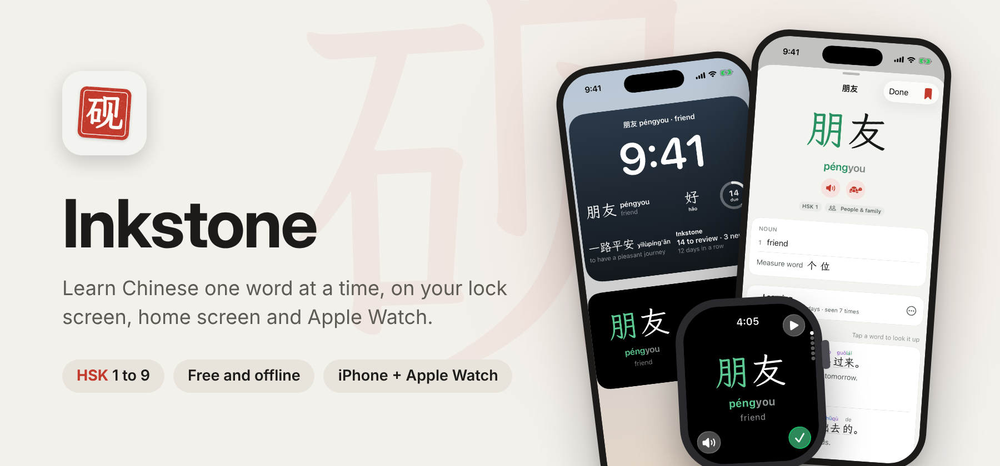
  </picture>
</p>

<p align="center">
  <a href="https://github.com/isgandarjafarli/inkstone/actions/workflows/ios.yml"></a>
  
  
  
  
</p>

<p align="center">
  <a href="#screenshots">Screenshots</a> ·
  <a href="#features">Features</a> ·
  <a href="#install-on-your-iphone">Install</a> ·
  <a href="#apple-watch">Apple Watch</a> ·
  <a href="#troubleshooting">Troubleshooting</a> ·
  <a href="#how-it-works">How it works</a> ·
  <a href="#credits">Credits</a>
</p>

**Inkstone** teaches Chinese vocabulary from the HSK exam lists, a few words a day. The word you are learning sits on your lock screen, your home screen and your watch face, so you see it dozens of times a day without opening anything. When you do sit down to study, short sessions mix meaning, listening, tones and handwriting, and a spaced repetition scheduler brings each word back just before you would forget it.

It is a native SwiftUI app for iPhone and Apple Watch. It is free, works offline, and needs no account. You install it from Xcode with your own Apple ID.

| At a glance | |
| --- | --- |
| 📚 **Words** | 11,470 words across the HSK 2026, HSK 3.0 and HSK 2.0 lists, in 15 topics |
| 💬 **Sentences** | 15,193 real example sentences with pinyin and English |
| ✍️ **Characters** | 3,034 characters with stroke order and their parts |
| 🧠 **Reviews** | FSRS-5 spaced repetition, with a memory target you choose |
| 🎨 **Tone colours** | Each tone has its own colour, on pinyin and on characters |
| ⌚ **Devices** | iPhone on iOS 17 or newer, Apple Watch on watchOS 10 or newer |
| 🔒 **Privacy** | Everything stays on your phone. No ads, accounts, tracking or network calls |

## Screenshots

These are taken automatically by the cloud build on every change, in the iPhone 17 Pro and Apple Watch simulators.

### iPhone app

<table>
  <tr>
    <td align="center">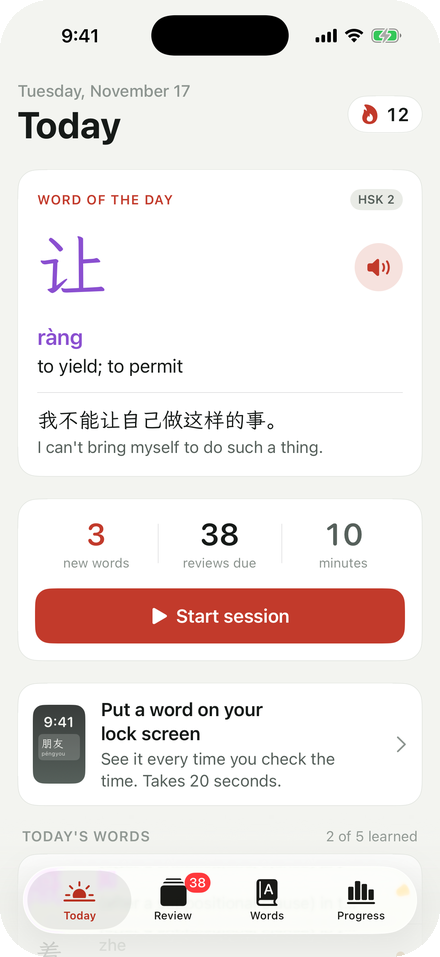<br><sub><b>Today</b><br>Word of the day and your session</sub></td>
    <td align="center">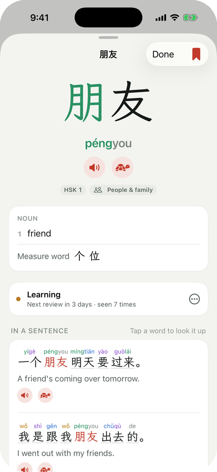<br><sub><b>Word page</b><br>Meanings and real sentences</sub></td>
    <td align="center">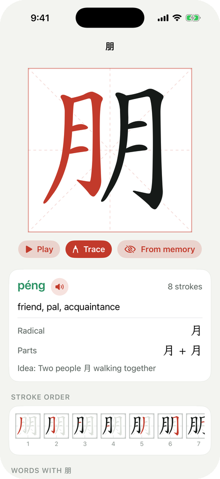<br><sub><b>Characters</b><br>Stroke order, trace, recall</sub></td>
    <td align="center">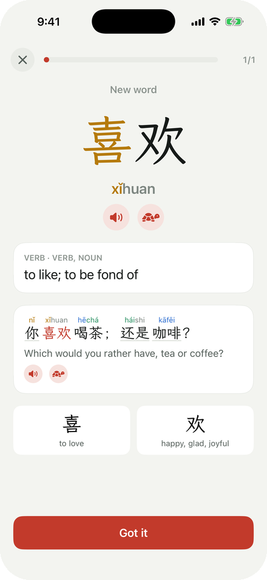<br><sub><b>New word</b><br>Meet it, hear it, see it used</sub></td>
  </tr>
  <tr>
    <td align="center">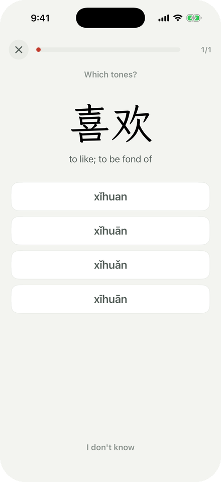<br><sub><b>Tones</b><br>Pick the right tone marks</sub></td>
    <td align="center">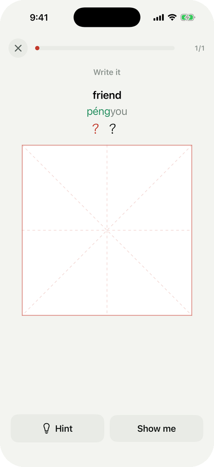<br><sub><b>Handwriting</b><br>Write it from memory</sub></td>
    <td align="center">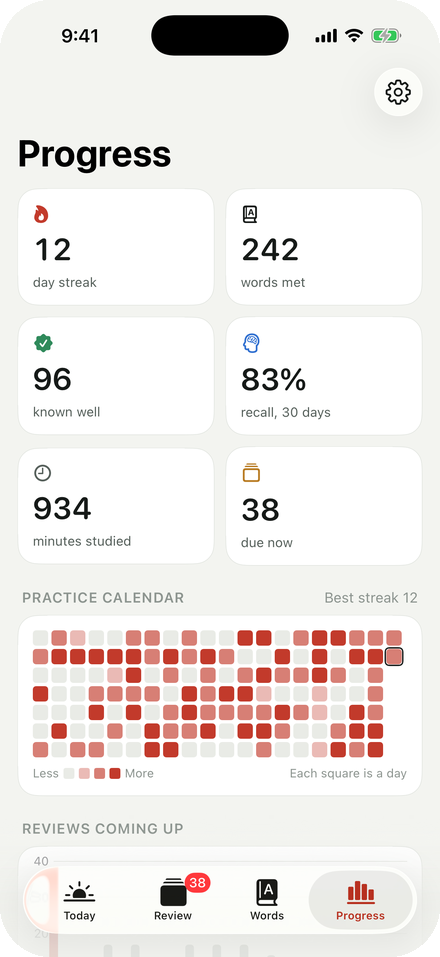<br><sub><b>Progress</b><br>Streak, recall and calendar</sub></td>
    <td align="center">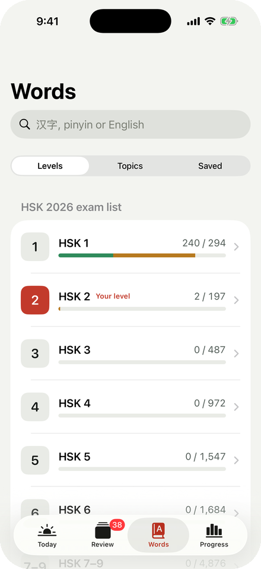<br><sub><b>Word lists</b><br>Every level, topic and saved word</sub></td>
  </tr>
</table>

### Widgets

<table>
  <tr>
    <td align="center">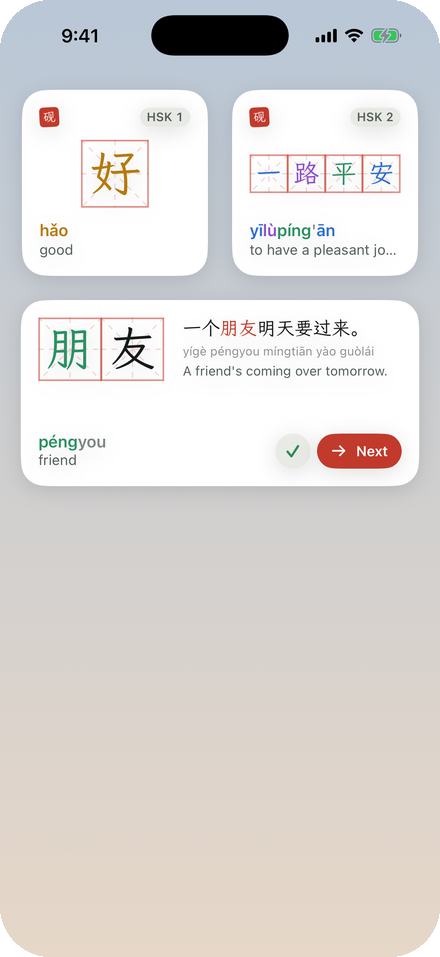<br><sub><b>Home screen</b><br>Small and medium</sub></td>
    <td align="center">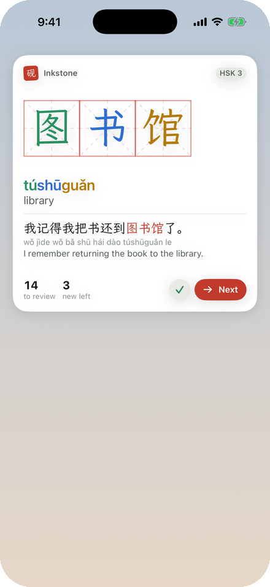<br><sub><b>Large</b><br>With a sentence and buttons</sub></td>
    <td align="center">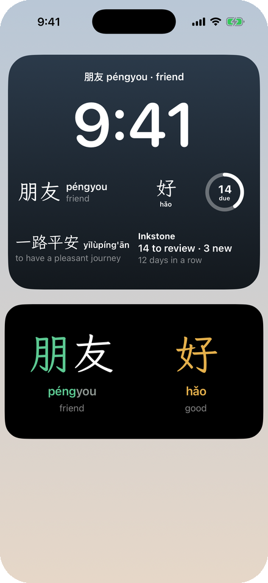<br><sub><b>Lock screen and StandBy</b><br>A word every time you check the time</sub></td>
    <td align="center">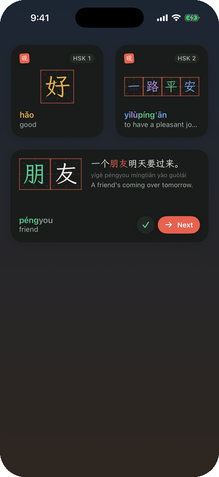<br><sub><b>Dark mode</b><br>Everything has a dark look</sub></td>
  </tr>
</table>

### Apple Watch

<table>
  <tr>
    <td align="center">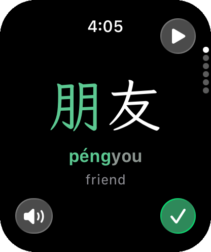<br><sub><b>Word carousel</b><br>Turn the crown for the next word</sub></td>
    <td align="center">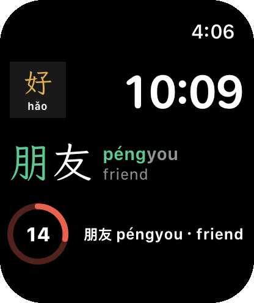<br><sub><b>Watch face</b><br>A rotating word on your face</sub></td>
    <td align="center">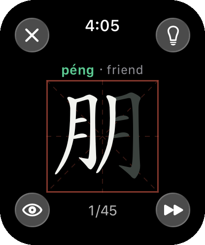<br><sub><b>Write</b><br>The whole screen is your page</sub></td>
  </tr>
  <tr>
    <td align="center">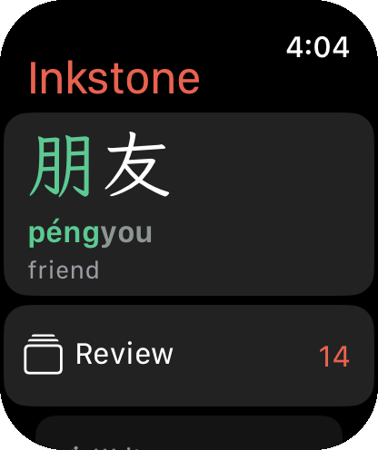<br><sub><b>Home</b><br>Current word and reviews</sub></td>
    <td align="center">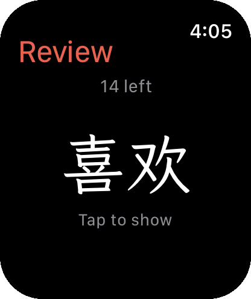<br><sub><b>Review</b><br>Tap to reveal, then ✓ or ✗</sub></td>
    <td align="center">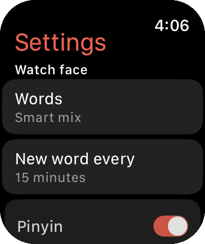<br><sub><b>Settings</b><br>Which words, how often</sub></td>
  </tr>
</table>

## Features

### Study

| Feature | What it does |
| --- | --- |
| **Daily new words** | 1 to 30 new words a day (5 by default), from your level and the topics you pick |
| **Mixed questions** | Meaning, pick the word, listening, tones, handwriting and "do you remember?" cards |
| **Spaced repetition** | FSRS-5 picks the day each word comes back. Words you miss return later in the same session |
| **Stroke order** | Watch each character drawn, trace it, then write it from memory. Slips are counted |
| **Real sentences** | Example sentences with pinyin over every word. Tap any word to look it up |
| **Pronunciation** | The Chinese voice built into iOS, at normal or slow speed |
| **Progress** | Streak, words met, words known well, 30-day recall, minutes studied and a practice calendar |
| **Reminders** | An optional daily reminder at the time you choose |
| **Backup** | Export your progress to a file and import it again on any phone |

### Word lists

Pick a list and a level when you start. You can change both later in Settings.

| Level | HSK 2026 exam list | HSK 3.0 (2021 standard) | HSK 2.0 (classic) |
| :---: | ---: | ---: | ---: |
| 1 | 294 | 506 | 150 |
| 2 | 197 | 750 | 147 |
| 3 | 487 | 953 | 298 |
| 4 | 972 | 972 | 598 |
| 5 | 1,547 | 1,059 | 1,298 |
| 6 | 1,684 | 1,123 | 2,500 |
| 7 to 9 | 4,876 | 5,606 | |
| **Total** | **10,057** | **10,969** | **4,991** |

Not sure of your level? The one-minute check during setup suggests one.

### Tone colours

<picture>
  <source media="(prefers-color-scheme: dark)" srcset="docs/images/tones-dark.png">
  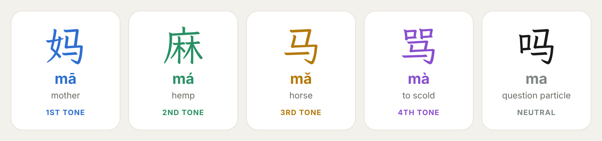
</picture>

Each tone has its own colour, so you can see the tones as well as hear them. Neutral-tone characters stay in the normal ink colour, and their pinyin is grey. Pinyin and characters each have their own switch in **Settings**.

| Where | Tone colours |
| --- | :---: |
| App screens | ✅ |
| Home screen widgets | ✅ |
| StandBy | ✅ |
| Apple Watch app | ✅ |
| Watch face | ✅ on full-colour faces |
| iPhone lock screen | ➖ iOS draws lock screen widgets in a single colour |

### Widgets

| Widget | Where it goes | What it shows |
| --- | --- | --- |
| **Word** | Lock screen (wide, round, one line), home screen (small, medium, large), StandBy | A word with pinyin and meaning. Medium and large add an example sentence and **✓ I know it** and **Next** buttons that work without opening the app |
| **Today's study** | Lock screen (round, wide, one line), home screen (small) | Reviews due, new words left and your streak |

Press and hold a widget and tap **Edit Widget** to choose:

| Setting | Choices |
| --- | --- |
| Words | Smart mix, today's words, words you are learning, your level, saved words |
| New word every | 15 minutes to a day |
| Show | Pinyin and meaning on or off |

## Install on your iPhone

Inkstone is not on the App Store. You build it on your Mac with Xcode and put it on your iPhone with your normal Apple ID. No paid developer account is needed. It takes about 15 minutes the first time, most of it waiting for Xcode to download.

| You need | Notes |
| --- | --- |
| 💻 A Mac with Xcode 16 or newer | Free in the Mac App Store. It is a large download |
| 📱 An iPhone on iOS 17 or newer | And a cable to connect it to the Mac |
| ⌚ An Apple Watch on watchOS 10 or newer | Optional. It must be paired with that iPhone |
| 🍎 Your Apple ID | A free one works |

### 1. Get the project

On this page, click the green **Code** button, then **Download ZIP**. Unzip it and double-click `Inkstone.xcodeproj`.

<details>
<summary>Or with git</summary>

```sh
git clone https://github.com/isgandarjafarli/inkstone.git
open inkstone/Inkstone.xcodeproj
```

</details>

### 2. Install Xcode and sign in

1. Install Xcode from the Mac App Store and open it once. When it asks which platforms to add, tick **iOS**, and **watchOS** if you have a watch.
2. Choose **Xcode → Settings → Accounts**, click **+**, choose **Apple ID** and sign in.

### 3. Let Xcode sign the app

1. In the left sidebar, click the blue **Inkstone** project icon at the top.
2. Under **TARGETS**, click **Inkstone**, then the **Signing & Capabilities** tab.
3. Make sure **Automatically manage signing** is ticked, and set **Team** to *your name (Personal Team)*.
4. Do the same for the other three targets:

| Target | What it is |
| --- | --- |
| `Inkstone` | The iPhone app |
| `InkstoneWidget` | The iPhone widgets |
| `InkstoneWatch` | The Apple Watch app |
| `InkstoneWatchWidget` | The watch face complications |

> [!TIP]
> If Xcode says the bundle identifier "is not available", open `Config/Signing.xcconfig`, change the last part of `INKSTONE_BUNDLE_PREFIX` (for example to `app.inkstone.yourname2026`) and click **Try Again**. If the **App Groups** box shows the group in red, click the small refresh button next to it.

### 4. Get your iPhone ready

1. Plug the iPhone into the Mac and tap **Trust** on the phone.
2. On the iPhone, open **Settings → Privacy & Security → Developer Mode**, turn it on and let the phone restart. The option only appears after the phone has been connected to Xcode.

### 5. Install

1. At the top of the Xcode window, choose your iPhone in the device menu.
2. Press **▶** (or ⌘R). The first build takes a minute or two.
3. If the iPhone says "Untrusted Developer", open **Settings → General → VPN & Device Management**, tap your Apple ID and tap **Trust**. Then open Inkstone.

### 6. Add the widgets

| Where | How |
| --- | --- |
| **Lock screen** | Lock the phone, press and hold the lock screen, tap **Customize → Lock Screen**, tap the box under the clock and choose **Inkstone**. Tap the date line above the clock to add the one-line widget too |
| **Home screen** | Press and hold an empty area, tap **Edit → Add Widget** and search for **Inkstone** |
| **StandBy** | Charge the phone on its side. The small widget works there |

### Keeping it working

Apps you install with a free Apple ID stop opening after 7 days. To renew, plug the phone in and press **▶** again. Your progress is kept.

| | Free Apple ID | Apple Developer Program |
| --- | --- | --- |
| Cost | Free | $99 a year |
| How long an install lasts | 7 days | 1 year |
| To renew | Plug in, press ▶ in Xcode | Same, once a year |

> [!TIP]
> For a more natural voice, download an enhanced Chinese voice in **Settings → Accessibility → Spoken Content → Voices → Chinese**.

## Apple Watch

The watch app shows today's words, runs quick reviews, and lets you practise writing on the whole screen. It gets your words from the iPhone and sends your answers back.

### Install on the watch

1. Keep the iPhone plugged in. Wear the watch, unlocked and close to the phone.
2. In Xcode, open **Window → Devices and Simulators** and wait while Xcode prepares the watch. The first time can take 10 to 30 minutes.
3. On the watch, turn on **Settings → Privacy & Security → Developer Mode** and let it restart.
4. In the scheme menu at the top of Xcode, choose **InkstoneWatch**, choose your watch in the device menu, and press **▶**.
5. Open Inkstone on the iPhone once, so it sends your words to the watch.

### What it does

| Screen | What it does |
| --- | --- |
| **Word carousel** | Today's words, one per page. Turn the Digital Crown to move on, tap ▶ to move on by itself, 🔊 to hear the word, ✓ to mark it known |
| **Review** | Words due today. Tap to see the answer, then ✓ or ✗. Results go back to the iPhone |
| **Write** | Write each character with your finger, with or without the outline. 💡 shows the next stroke |
| **Settings** | Which words the watch face shows and how often they change: every 5, 15, 30 or 60 minutes |

### Watch face complications

Touch and hold the watch face, tap **Edit**, swipe to the complications, tap a spot and choose **Inkstone**.

| Complication | Shapes | What it shows |
| --- | --- | --- |
| **Word** | Round, wide, corner, one line | A word that changes every few minutes, with pinyin and meaning where there is room |
| **Reviews due** | Round, wide, corner, one line | How many words are waiting for review today |

The Word complication also works in the Smart Stack: turn the Digital Crown from the watch face.

## Troubleshooting

| Problem | Fix |
| --- | --- |
| "The bundle identifier is not available" | Change the last part of `INKSTONE_BUNDLE_PREFIX` in `Config/Signing.xcconfig`, then click **Try Again** |
| The App Groups box is red | Click the refresh button next to it, or set the Team again |
| No Developer Mode option on the iPhone | Connect the iPhone to Xcode first, then look again |
| "Untrusted Developer" | **Settings → General → VPN & Device Management**, tap your Apple ID, tap **Trust** |
| The app stopped opening after a week | That is the 7-day limit of a free Apple ID. Plug in and press ▶ again |
| The watch is not in Xcode's device menu | Open **Window → Devices and Simulators**, keep the watch unlocked near the phone, and wait |
| The watch only shows HSK 1 words | Open Inkstone on the iPhone once so it sends your words |
| A widget shows old words | Open the app once. Widgets also refresh by themselves on the schedule you chose |

## How it works

<picture>
  <source media="(prefers-color-scheme: dark)" srcset="docs/images/diagram-dark.png">
  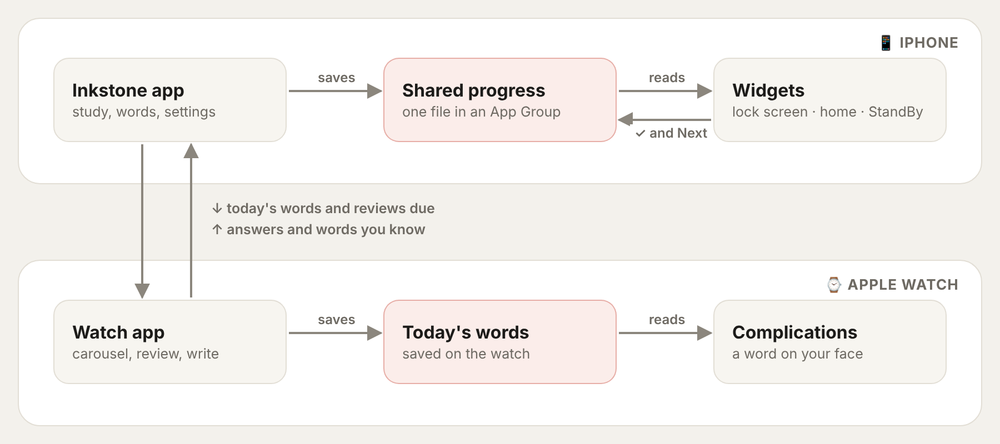
</picture>

- **One source of truth.** Your progress is a single file in an App Group that the app and its widgets share. Widget buttons change it directly, so you can mark a word known without opening the app.
- **Spaced repetition.** Each word has a stability and a difficulty. FSRS-5 uses them to pick the day it comes back, aiming for the memory target you set (90% by default). A new study day starts at 4 a.m., so late-night study counts for the day before.
- **The watch.** The iPhone sends the watch a short list of word ids whenever your progress changes. The watch looks the words up in its own copy of the word list, so it works when the phone is out of reach, and sends answers back the next time they connect.
- **All offline.** Words, sentences, stroke data and the font are bundled with the app. Speech uses the voice built into iOS.

## Project layout

| Folder | Contents |
| --- | --- |
| `App` | The iPhone app: screens, study sessions, dictionary and data |
| `Widget` | The iPhone widget extension |
| `Watch` | The Apple Watch app: carousel, reviews, writing practice and settings |
| `WatchWidget` | The watch face complications |
| `WatchShared` | Code shared by the watch app and its complications |
| `Shared` | Code and data shared by everything: spaced repetition, progress, theme, stroke data and font |
| `Tests` | Unit tests. Press ⌘U in Xcode |
| `Config` | Signing settings, Info.plist files and entitlements |
| `scripts` | Screenshot scripts used by the cloud build |
| `.github/workflows` | The cloud build |

### Cloud build

Every push runs [Build and test](https://github.com/isgandarjafarli/inkstone/actions/workflows/ios.yml) on a GitHub Mac:

| Step | Result |
| --- | --- |
| Build all four targets and run the unit tests | 31 tests |
| Build an unsigned iPhone app | `Inkstone-unsigned.ipa` |
| Take iPhone screenshots in light and dark mode | 30 screens |
| Take Apple Watch screenshots | 6 screens |

The results, logs and screenshots are saved to the [`ci-results`](https://github.com/isgandarjafarli/inkstone/tree/ci-results) branch. When GitHub's Apple silicon Macs are busy, start a run by hand from the Actions tab and choose `macos-15-intel`.

## Credits

Inkstone is built on open data and an open font:

| What | Source | Licence |
| --- | --- | --- |
| HSK 2.0, 3.0 and 2026 word lists | [complete-hsk-vocabulary](https://github.com/drkameleon/complete-hsk-vocabulary) by drkameleon | MIT |
| Definitions | [CC-CEDICT](https://cc-cedict.org/wiki/) | CC BY-SA 4.0 |
| Example sentences | [Tatoeba](https://tatoeba.org) | CC BY 2.0 FR |
| Stroke order, character outlines, parts and hints | [Make Me a Hanzi](https://github.com/skishore/makemeahanzi) by Shaunak Kishore | Arphic Public License (graphics), LGPL (dictionary) |
| Chinese font (subset) | [LXGW WenKai](https://github.com/lxgw/LxgwWenKai) | SIL Open Font License 1.1 |
| Review scheduling | [FSRS-5](https://github.com/open-spaced-repetition) | MIT |

The same list is in [`CREDITS.md`](CREDITS.md) and in the app under **Settings → About and data sources**. Settings opens from the gear on the Progress tab. Inkstone is an independent project and is not affiliated with Daily Hanzi or any other app.
